<div align="center">

<a href="https://dimasaas.github.io/Dimasaas/"></a>

<br>

<a href="https://www.linkedin.com/in/diamantinojv/"></a>
<a href="https://1001imoveis.com"></a>

<a href="https://dimasaas.github.io/Dimasaas/"></a>

<br><br>

**CTO (Diretor de T.I.) na 1001 Negócios Imobiliários** · Estudante de Análise e Desenvolvimento de Sistemas na PUC Goiás · Goiânia, GO

Eu construo o software que roda a operação de uma imobiliária de loteamentos, e escrevo o código que fica em volta dele.


</div>

## 🪐 A órbita

As tecnologias que eu uso toda semana, em produção ou no fluxo de trabalho. Biblioteca que eu só "já usei uma vez" não entra.

<div align="center">
</div>

## 🖥️ Sistemas que eu construo (mockups com dados fictícios)

<table>
<tr>
<td width="50%"></td>
<td width="50%"></td>
</tr>
</table>

<div align="center">
</div>

<sub>Ilustrações feitas do zero; os dados são fictícios.</sub>

## 🚀 Vitrine

Código aberto que eu escrevi e mantenho. Clique no cartão para abrir o repositório.

<table>
<tr>
<td width="50%"><a href="https://github.com/Dimasaas/plotline"></a></td>
<td width="50%"><a href="https://github.com/Dimasaas/gatehouse"></a></td>
</tr>
<tr>
<td width="50%"><a href="https://github.com/Dimasaas/breather"></a></td>
<td width="50%"><a href="https://github.com/Dimasaas/shopkeep">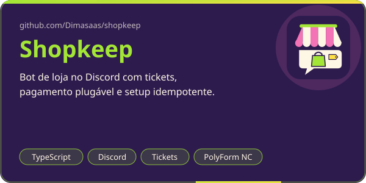</a></td>
</tr>
<tr>
<td width="50%"><a href="https://github.com/Dimasaas/penny"></a></td>
<td width="50%"><a href="https://github.com/Dimasaas/breeze"></a></td>
</tr>
<tr>
<td width="50%"><a href="https://github.com/Dimasaas/RendeChapa"></a></td>
<td width="50%"><a href="https://github.com/Dimasaas/dias-uteis-br"></a></td>
</tr>
<tr>
<td width="50%"><a href="https://github.com/Dimasaas/DiscordNodeStereo"></a></td>
<td width="50%"><a href="https://github.com/Dimasaas/pi-3b-gerenciador-de-tarefas"></a></td>
</tr>
</table>

<sub>Os projetos Plotline, Gatehouse, Breather, Shopkeep, Penny e Breeze usam a licença **PolyForm Noncommercial 1.0.0**: dá para ler e estudar à vontade, mas não para comercializar.</sub>

## 🧭 Como eu trabalho

```text
01  a regra mora no código, com teste
02  operação sensível tem trava própria
03  dado sensível não sai da nossa infraestrutura
```

## 📡 Ao vivo

<div align="center">

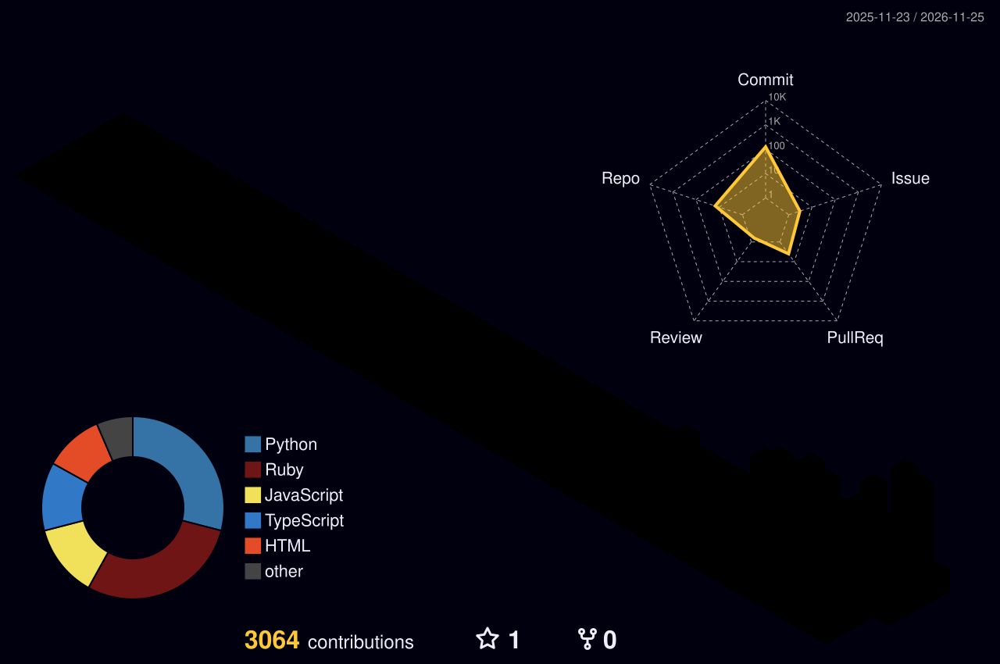

<picture>
  <source media="(prefers-color-scheme: dark)" srcset="https://raw.githubusercontent.com/Dimasaas/Dimasaas/output/cobra-escura.svg">
  
</picture>


</div>

<details>
<summary>🔒 não clique aqui</summary>

```text
$ sudo contratar --joao
[sudo] senha para recrutador: ********

   ╔══════════════════════════════════════════╗
   ║   ACESSO CONCEDIDO.  Boa escolha.        ║
   ╚══════════════════════════════════════════╝
        \   ^__^
         \  (oo)\_______
            (__)\       )\/\
                ||----w |
                ||     ||

   processo "contratar" iniciado em segundo plano...
   o café já está na conta.
   próximo passo: https://www.linkedin.com/in/diamantinojv/
```

👉 [**abrir o LinkedIn**](https://www.linkedin.com/in/diamantinojv/)

</details>

<br>


